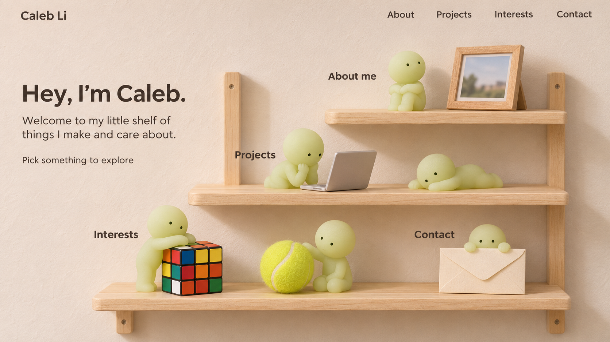

# Shelf concept

The first daytime composition explores the "Smiskis on a Shelf" direction described in [PRODUCT.md](../../PRODUCT.md).

This is an art-direction study generated with the built-in ImageGen tool. It is not an implemented page or a decision to use one flat image as the website. Typography, scene labels, shelf geometry, character likeness, and object placement remain open to review.

The exact generation prompt is saved in [shelf-daytime-v1-prompt.txt](shelf-daytime-v1-prompt.txt).

## What to review

- The warmth, materials, character scale, and balance between the introductory text and the shelf.
- Whether the photo, laptop, cube, tennis ball, and envelope make each scene understandable.
- Whether the composition feels personal and leaves enough empty space.

## Next prototype

After reviewing the visual direction, test one complete interaction: select the laptop, read a project in a spacious content view, return to the shelf, and navigate with browser history. Test a mobile layout before choosing layered illustration or full 3D. Capture the agreed visual rules in DESIGN.md as the direction settles.

Night lighting, additional animation, and hidden interactions are later enhancements. The existing portfolio application is unchanged by this study.
