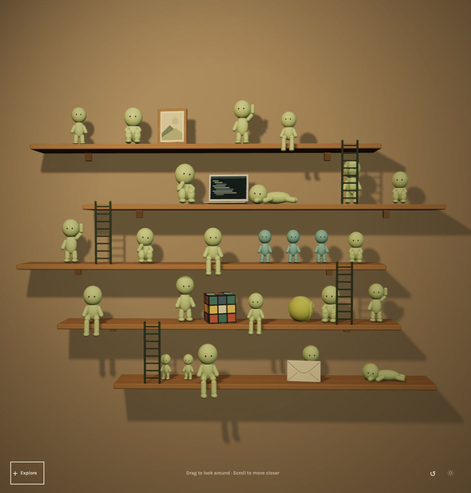

# Immersive shelf alternative

## Scope

An interactive Three.js prototype at `/shelf`, using the user's collection photograph as a reference for five thin, staggered wooden platforms, ladders, and a denser arrangement of figures. The existing homepage at `/` remains unchanged.

The entrance is the shelf itself. Warm illumination, shadows, real object depth, a constrained orbit camera, and scroll/pinch zoom establish the atmosphere. The small controls at the bottom provide direct navigation, reset, and a dim-light experiment.

## Try it

1. Run `npm ci` and `npm run dev`, then visit `/shelf`.
2. Drag the wall or shelf to look around; scroll or pinch to move closer.
3. Hover the frame, laptop group, cube/ball group, or envelope for a label. Select the object or use Explore to open its content.
4. Use the section navigation, browser back/forward, Back to shelf, or Escape. Direct links such as `/shelf#projects` open the same content.
5. Use the lighting control to compare warm and dim illumination. Reset returns the camera to the full shelf.

## Rendering and access

The models are procedural geometry, not a flat generated image. Materials include locally generated wood grain and wall textures; the frame contains an illustrative landscape rather than a fabricated personal photograph. The scene is loaded separately from the original homepage. Desktop uses a side reading area; mobile uses full-width content. Semantic scene buttons and a text menu provide keyboard access, and a fallback navigation view appears if scene initialization fails. Without JavaScript, visitors can access the existing portfolio.

The scene caps pixel density, reuses geometry and materials, reuses static shadows, skips drawing when nothing changes, and disposes rendering resources when unmounted. Reduced-motion preferences disable camera transitions.

## Still exploratory

- The figure sculpts establish proportions and poses. Refine their likeness and materials before treating them as final assets.
- Improve shadow softness, final camera limits, and mobile density after visual review.
- Existing project data is reused. Screenshots, deeper case studies, current role dates, and detailed interests remain future content work.
- The app build and TypeScript checks validate the prototype; existing dependency audit findings are outside this design exploration.
- This branch is an alternative to the static daytime study in PR #2. Merging both requires reconciling their PRODUCT.md descriptions around the preferred direction.
