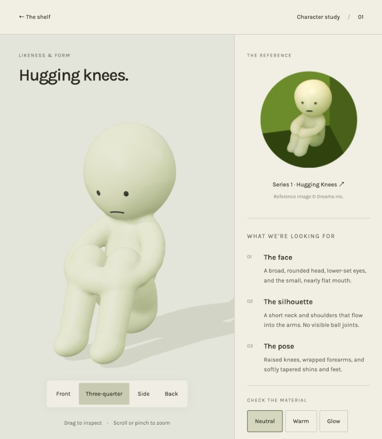

# Smiski likeness study

Review a single **Hugging Knees** figure at `/smiski-study/`. The model uses the [official Series 1 photo](https://smiski.com/e/products/series-1/) for the folded pose, rounded head, low face, small mouth, and pale material. The reference photo is linked in the viewer and is not packaged with the model.

Use Front, Three-quarter, Side, and Back to check the silhouette. Drag to orbit, or scroll or pinch to zoom. Neutral, Warm, and Glow show how the face and material read under different light. The side view is especially useful for checking the grounded seated pose and the shoulder and neck transitions.

## Asset and source

- [Downloadable GLB](../../public/models/smiski-hugging-knees-study.glb), with an indexed, continuous body and separate painted facial marks.
- [Offline sculpt generator](../../scripts/sculpt-smiski.mjs). Run `node scripts/sculpt-smiski.mjs` from the repository root to rebuild the GLB and its [topology report](smiski-hugging-knees-study.json).
- The generator blends a shaped torso, curved limbs, and tapered head into a single implicit surface, extracts the mesh, welds vertices, and checks body connectivity and edge topology before export.

This is a high-detail review asset, not a rigged or optimized model for the full shelf. Confirm the likeness and material before deriving additional poses and preparing lower-detail shelf versions. The current homepage and shelf collection do not use this asset yet.
